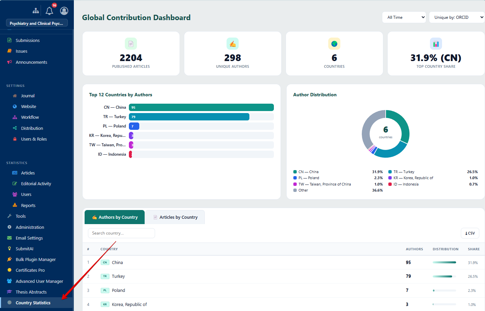
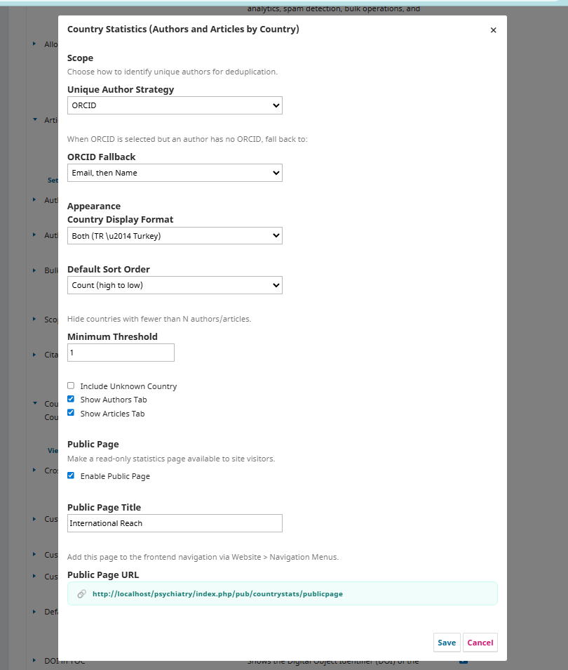
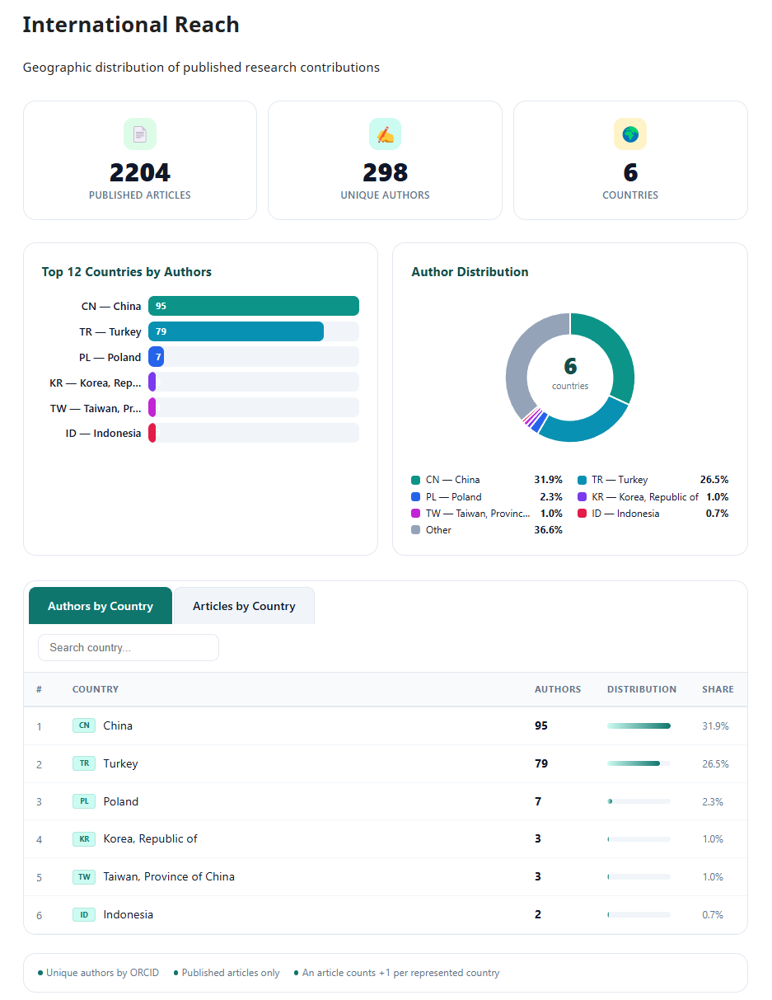

# Country Statistics (Authors and Articles by Country)

Country Statistics, Open Journal Systems (OJS) 3.3 için geliştirilmiş kapsamlı bir analiz eklentisidir. Dergi yöneticilerine ve editörlere, yazar ve makalelerin ülkelere göre coğrafi dağılımını görsel ve etkileşimli bir panoyla sunar. Bir derginin yazar çeşitliliğinin coğrafi dağılımı; Web of Science, Scopus, DOAJ ve diğer uluslararası veri tabanlarına yapılan indeks başvurularında kritik bir değerlendirme kriteridir. Bu indeksleme kuruluşları, derginin geniş bir ülke yelpazesinden yazar çekip çekmediğini uluslararası geçerlilik ve akademik etki göstergesi olarak değerlendirir. Bu eklenti, söz konusu verileri zahmetsizce takip etmenizi ve sunmanızı sağlar.

Akademik yayıncılıkta, katkıda bulunan yazarların nerelerden geldiğini anlamak; derginin uluslararası erişimini değerlendirmek, bölgesel güçlü yanları belirlemek ve yeterince temsil edilmeyen bölgeler için stratejik planlama yapmak açısından büyük önem taşır. Country Statistics, yayımlanmış makalelerin meta verilerini analiz ederek her yazarın ülke bilgisini belirler ve bu verileri anlamlı istatistiklere dönüştürür. ORCID tanımlayıcıları ile akıllı yazar tekillleştirmesi yapar ve yapılandırılabilir yedek stratejiler (e-posta, tam isim) sunar. Böylece birden fazla makalede yer alan yazarlar yalnızca bir kez sayılır.

Sonuçlar; en çok katkı sağlayan ülkeleri gösteren çubuk grafikler, oransal dağılımı gösteren halka grafikler ve ülke bazında detaylı, aranabilir ve sıralanabilir tablolar aracılığıyla sunulur. Dergi yöneticileri tüm verileri daha fazla analiz, raporlama veya indeks başvurularına eklenmek üzere CSV olarak dışa aktarabilir. Yönetim panosunun yanı sıra, eklenti ayarlarından etkinleştirilebilen ve özelleştirilebilen isteğe bağlı bir herkese açık sayfa da sunar. Bu sayfa, dergilerin uluslararası çeşitliliklerini potansiyel yazar, hakem, okuyucu ve indeksleme komitelerine şeffaf bir şekilde sergilemesine olanak tanır. Sayfa, OJS'nin yerleşik Gezinti Menüsü sistemi aracılığıyla herhangi bir ön yüz menüsüne eklenebilir ve derginin mevcut web sitesi yapısıyla sorunsuz bir şekilde bütünleşir.

Eklenti tamamen bağımsızdır ve harici hiçbir kütüphaneye ihtiyaç duymaz — tüm grafikler saf SVG ve vanilla JavaScript ile oluşturulur, bu da hızlı yükleme süreleri ve geniş tarayıcı uyumluluğu sağlar. İngilizce ve Türkçe dil desteği yerleşik olarak gelir ve ek diller `.po` dosyaları ile kolayca eklenebilir. Gösterim formatı, sıralama düzeni, minimum eşik değerler, sekme görünürlüğü ve daha fazlası yapılandırılabilir.

## Uyumluluk

| OJS Sürümü | Eklenti Sürümü | Durum |
|------------|---------------|-------|
| 3.3.x      | 1.0.0.0       | ✅ Destekleniyor |

## Özellikler

- **Yönetim Panosu** — Özet kartlar, çubuk grafik (en çok 12 ülke), halka grafik (yazar dağılımı), sekmeli veri tabloları, arama ve CSV dışa aktarma
- **Herkese Açık Sayfa** — Site ziyaretçileri için isteğe bağlı salt okunur istatistik sayfası, özelleştirilebilir başlık ve gezinti menüsü entegrasyonu
- **Akıllı Tekillleştirme** — ORCID, e-posta veya tam isim ile benzersiz yazar tanımlama ve yapılandırılabilir yedek zincirler
- **Esnek Filtreleme** — Zaman aralığı filtreleri, tekillleştirme stratejisi seçicileri, minimum eşik değerleri
- **Duyarlı Tasarım** — Yan panel içeren temalarda dar içerik alanlarına uyum sağlar
- **Sıfır Bağımlılık** — Saf SVG grafikler ve vanilla JavaScript, harici kütüphane gerekmez
- **Çok Dilli** — İngilizce ve Türkçe dahil, `.po` dosyaları ile genişletilebilir
- **Gezinti Menüsü Entegrasyonu** — Herhangi bir ön yüz menüsüne eklenebilen özel menü öğe türü
- **CSV Dışa Aktarma** — Yazar veya makale ülke verilerini UTF-8 desteği ile indirme

## Kurulum

1. En son sürümü [Releases](../../releases) sayfasından indirin
2. **Ayarlar > Web Sitesi > Eklentiler > Yeni Eklenti Yükle** yolunu izleyin
3. `.tar.gz` dosyasını yükleyin
4. Eklentiyi **Genel Eklentiler** altında etkinleştirin

**Alternatif (Manuel):**

1. Arşivi `plugins/generic/countryStats/` dizinine çıkartın
2. OJS kök dizininden `php tools/upgrade.php upgrade` komutunu çalıştırın
3. Eklenti Galerisinden eklentiyi etkinleştirin

## Yapılandırma

Eklentiyi etkinleştirdikten sonra, Eklenti Galerisinde **Ayarlar** düğmesine tıklayarak yapılandırın:

- **Benzersiz Yazar Stratejisi** — Yazarların nasıl tekillleştirileceğini seçin (ORCID, E-posta veya Tam İsim)
- **ORCID Yedeği** — ORCID seçildiğinde, yedek tanımlama yöntemini belirleyin (E-posta sonra İsim, Yalnızca E-posta, Yalnızca İsim veya Hiçbiri)
- **Ülke Gösterim Formatı** — Ülke kodu, tam ad veya her ikisini göster
- **Sıralama Düzeni** — Sayıya göre (azalan) veya ülke adına göre (artan)
- **Minimum Eşik** — Belirtilen yazar/makale sayısının altındaki ülkeleri gizle
- **Herkese Açık Sayfa** — Herkese açık istatistik sayfasını etkinleştir/devre dışı bırak ve başlığını ayarla

## Ekran Görüntüleri

### Yönetim Panosu

### Eklenti Ayarları

### Herkese Açık Sayfa

## Kullanım

### Panoya Erişim
Kurulumdan sonra OJS yönetim alanının sol kenar çubuğunda **Country Statistics** menü öğesi görüntülenir. Etkileşimli panoyu açmak için tıklayın.

### Ön Yüz Gezinti Menüsüne Ekleme
1. **Ayarlar > Web Sitesi > Gezinti Menüleri** yoluna gidin
2. İstediğiniz gezinti menüsünü düzenleyin
3. **Country Statistics** türünde yeni bir öğe ekleyin
4. Bağlantı otomatik olarak herkese açık istatistik sayfasına yönlendirilir

### Veri Dışa Aktarma
Yönetim panosunda, her sekmede (Yazarlara Göre Ülkeler / Makalelere Göre Ülkeler) bulunan **CSV** düğmesini kullanarak verileri indirebilirsiniz.

## Lisans

Bu eklenti [GNU Genel Kamu Lisansı v3.0](LICENSE) altında lisanslanmıştır.

## Destek

- Hata Bildirimleri ve Özellik İstekleri: [GitHub Issues](../../issues)
- E-posta: info@ojs-services.com
- Web Sitesi: [ojs-services.com](https://ojs-services.com)

## Geliştirici

**[OJS Services](https://github.com/ojs-services)**
