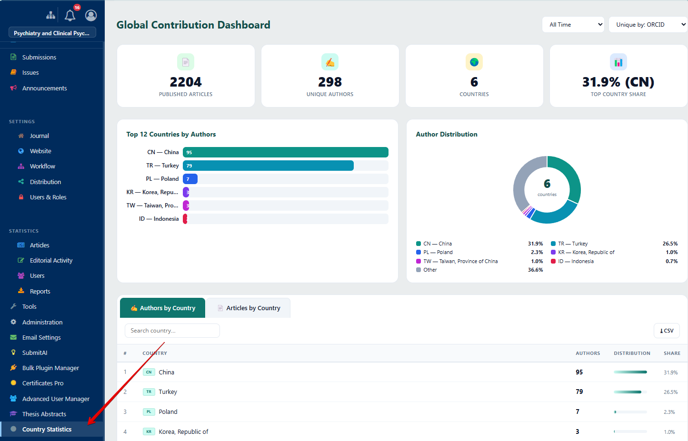
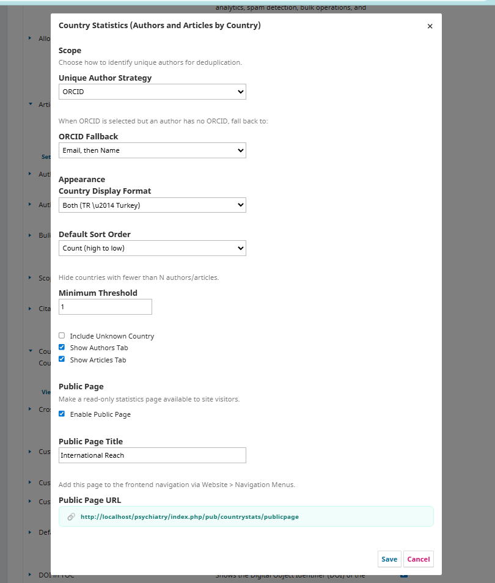
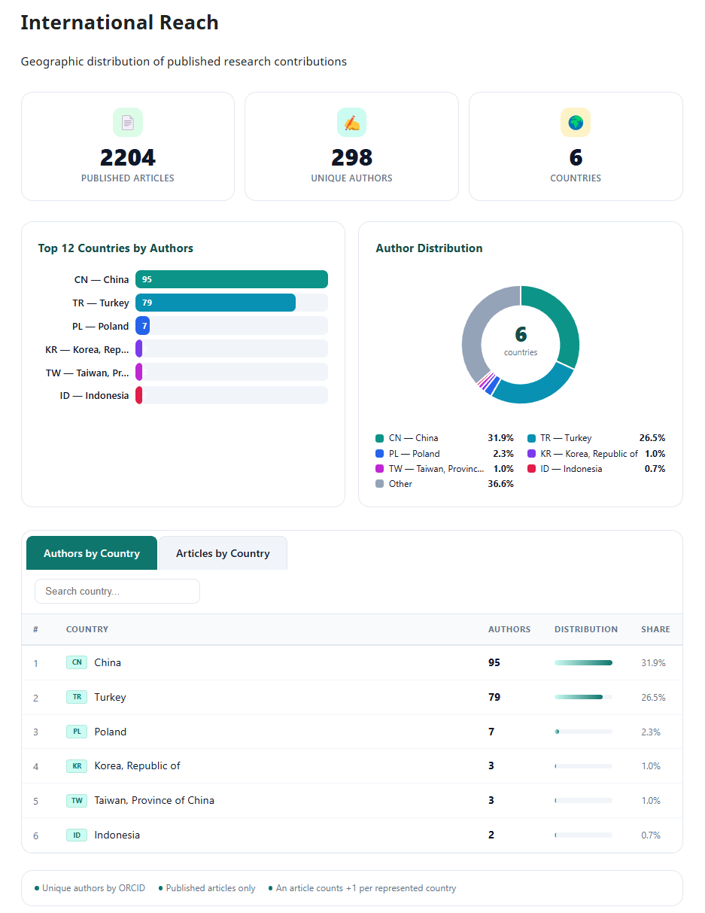

# Country Statistics (Authors and Articles by Country)

Country Statistics is a comprehensive analytics plugin for Open Journal Systems (OJS) 3.3 that provides journal managers and editors with a clear, visual overview of the geographic distribution of their authors and published articles. The geographic diversity of a journal's contributors is a critical metric in applications for prestigious indexes such as Web of Science, Scopus, DOAJ, and other international databases. These indexing bodies evaluate whether a journal attracts authors from a wide range of countries as an indicator of international relevance and scholarly impact. This plugin makes it effortless to track and present that data.

In academic publishing, understanding where your contributors come from is essential for evaluating a journal's international reach, identifying regional strengths, and planning strategic outreach to underrepresented areas. Country Statistics analyzes published submission metadata to determine each author's country of affiliation, then aggregates the data into meaningful statistics. It features intelligent author deduplication using ORCID identifiers with configurable fallback strategies (email, full name), ensuring that authors who appear in multiple publications are counted only once.

The resulting data is presented through bar charts showing top contributing countries, donut charts illustrating proportional distribution, and fully searchable, sortable tables with per-country breakdowns. Journal managers can export all data to CSV for further analysis, reporting, or inclusion in index applications. Beyond the administrative dashboard, the plugin offers an optional public-facing page that can be enabled and customized through the settings. This public page allows journals to transparently showcase their international diversity to prospective authors, reviewers, readers, and indexing committees. The page can be added to any frontend navigation menu through OJS's built-in Navigation Menu system, making it seamlessly integrated with the journal's existing website structure.

The plugin is entirely self-contained with no external dependencies — all charts are rendered using pure SVG and vanilla JavaScript, ensuring fast load times and broad browser compatibility. It supports English and Turkish out of the box, with an extensible locale system for adding additional languages. Every aspect of the display is configurable: country name format, sort order, minimum count thresholds, tab visibility, and more.

## Compatibility

| OJS Version | Plugin Version | Status |
|-------------|---------------|--------|
| 3.3.x       | 1.0.0.0       | ✅ Supported |

## Features

- **Admin Dashboard** — Summary cards, bar chart (top 12 countries), donut chart (author distribution), tabbed data tables with search and CSV export
- **Public Page** — Optional read-only statistics page for site visitors, customizable title and navigation menu integration
- **Smart Deduplication** — Unique author identification via ORCID, email, or full name with configurable fallback chains
- **Flexible Filtering** — Time range filters, unique strategy selectors, minimum count thresholds
- **Responsive Design** — Adapts to narrow content areas in themes with sidebars
- **Zero Dependencies** — Pure SVG charts and vanilla JavaScript, no external libraries
- **Multi-language** — English and Turkish included, extensible via `.po` locale files
- **Navigation Menu Integration** — Register as a custom Navigation Menu Item type for any frontend menu
- **CSV Export** — Download author or article country data with UTF-8 support

## Installation

1. Download the latest release from [Releases](../../releases)
2. Go to **Settings > Website > Plugins > Upload A New Plugin**
3. Upload the `.tar.gz` file
4. Enable the plugin under **Generic Plugins**

**Alternative (Manual):**

1. Extract the archive to `plugins/generic/countryStats/`
2. Run `php tools/upgrade.php upgrade` from the OJS root directory
3. Enable the plugin from the Plugin Gallery

## Configuration

After enabling the plugin, click **Settings** in the Plugin Gallery to configure:

- **Unique Author Strategy** — Choose how authors are deduplicated (ORCID, Email, or Full Name)
- **ORCID Fallback** — When ORCID is selected, define fallback identification (Email then Name, Email only, Name only, or None)
- **Country Display Format** — Show country code, full name, or both
- **Sort Order** — Sort by count (descending) or country name (ascending)
- **Minimum Threshold** — Hide countries below a specified author/article count
- **Public Page** — Enable/disable the public statistics page and set its title

## Screenshots

### Admin Dashboard

### Plugin Settings

### Public Page

## Usage

### Accessing the Dashboard
After installation, a **Country Statistics** menu item appears in the left sidebar of the OJS management area. Click it to open the interactive dashboard.

### Adding to Frontend Navigation
1. Go to **Settings > Website > Navigation Menus**
2. Edit your desired navigation menu
3. Add a new item of type **Country Statistics**
4. The link will automatically point to the public statistics page

### Exporting Data
On the admin dashboard, use the **CSV** button in each tab (Authors by Country / Articles by Country) to download the data.

## License

This plugin is licensed under the [GNU General Public License v3.0](LICENSE).

## Support

- Bug Reports & Feature Requests: [GitHub Issues](../../issues)
- Email: info@ojs-services.com
- Website: [ojs-services.com](https://ojs-services.com)

## Author

**[OJS Services](https://github.com/ojs-services)**
